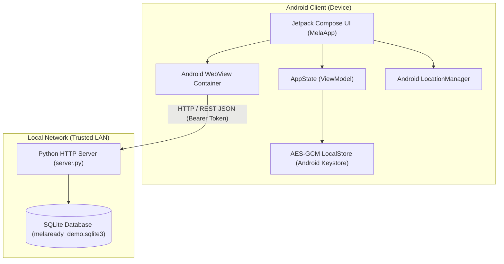
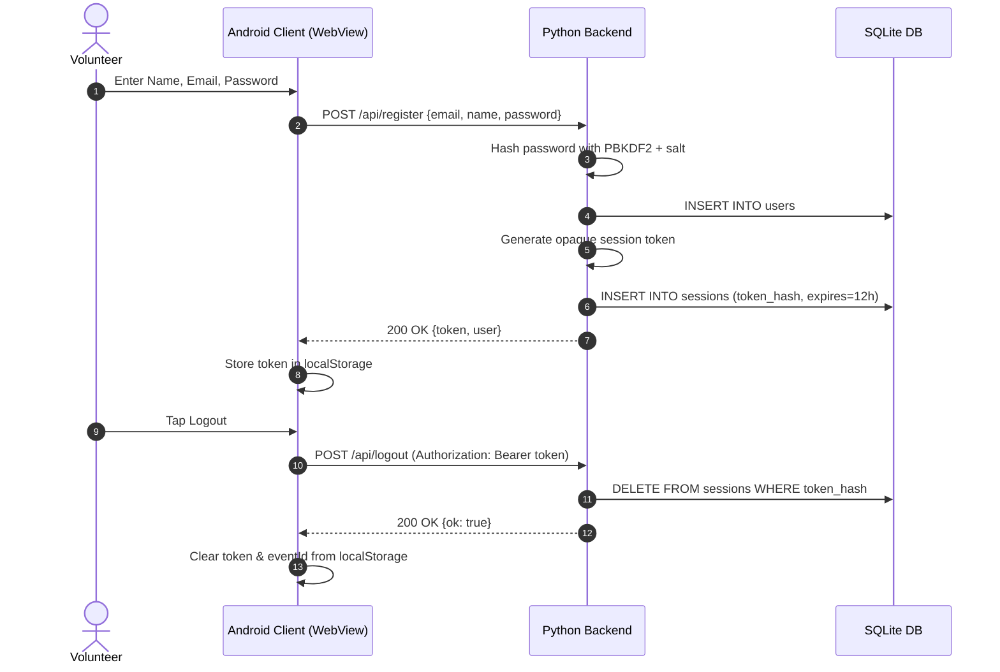
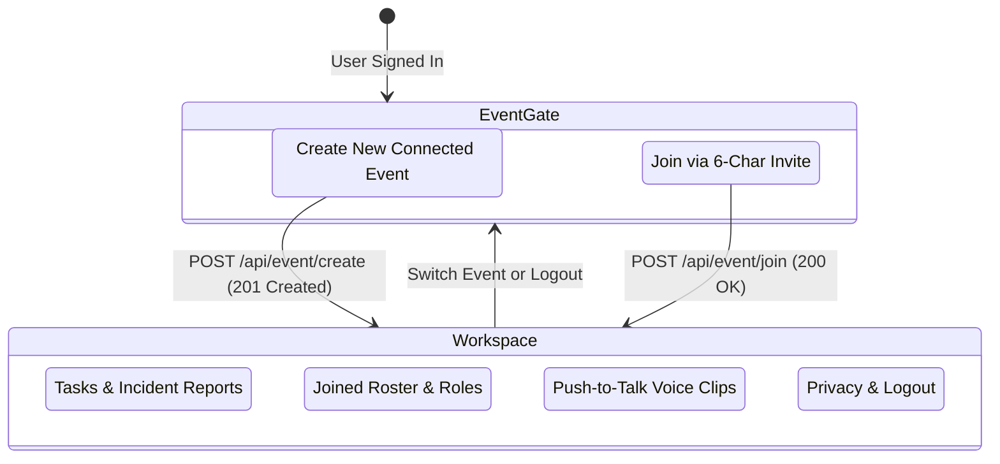
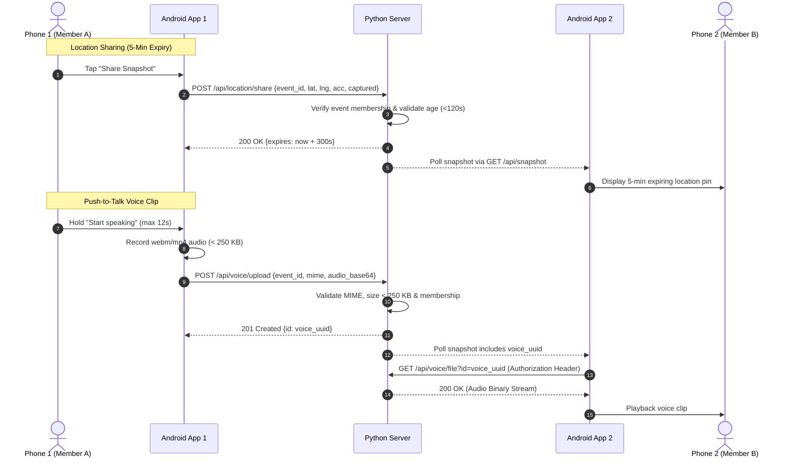

# MelaReady Technical Design Document

**Version**: 0.4.0  
**Project Theme**: Disaster Mitigation  
**Tagline**: Prepare · Practise · Coordinate  

---

## 1. System Overview & Architecture

MelaReady is a dual-tier native Android application paired with a lightweight, zero-dependency Python backend server (`server/server.py`). It is designed for offline-first disaster preparation, volunteer training, and local venue coordination during large public gatherings, cultural melas, and civic drills.

---

## 2. Authentication & Session Lifecycle

Authentication relies on PBKDF2 password hashing (`600,000` iterations) and opaque 256-bit session tokens stored on the server.

---

## 3. Event Creation & Join Workflow

Event organization uses short 6-character uppercase invite codes valid for 24 hours.

---

## 4. Location & Voice Data Flow

Both location snapshot sharing and Push-to-Talk voice clip distribution operate strictly on an explicit, opt-in basis within active event membership.

---

## 5. Security & Privacy Controls

1. **Local Data Protection**: All local workspace data (training progress, drill logs, offline event info) is stored using AES-256-GCM encryption with keys generated in the **Android Keystore**.
2. **Network Security**: Bearer tokens are submitted strictly in `Authorization: Bearer <token>` HTTP headers—never in URL query strings.
3. **No Background Tracking**: Location fixes are requested only on explicit user interaction and remain in volatile memory.
4. **On-Demand Microphone**: Microphone permissions (`RECORD_AUDIO`) are requested only when the user initiates voice clip recording. `MediaStream` audio tracks are explicitly stopped immediately after recording completes or fails.
5. **Session Expiry**: Inactive sessions automatically expire after 12 hours server-side.

---

## 6. Functional Endpoints Summary

| Endpoint | Method | Auth Required | Description |
| :--- | :--- | :--- | :--- |
| `/api/health` | `GET` | No | Returns service status and version without sensitive data |
| `/api/register` | `POST` | No | Creates new user account with hashed password |
| `/api/login` | `POST` | No | Authenticates credentials and returns opaque 12h session token |
| `/api/logout` | `POST` | Yes | Revokes current session token |
| `/api/events` | `GET` | Yes | Returns list of joined events for authenticated user |
| `/api/event/create` | `POST` | Yes | Creates new event and generates 6-character invite code |
| `/api/event/join` | `POST` | Yes | Joins user to event using valid invite code |
| `/api/snapshot` | `GET` | Yes | Fetches current members, tasks, reports, active locations, and voice clips |
| `/api/task/create` | `POST` | Yes | Team lead assigns task to joined member |
| `/api/task/advance` | `POST` | Yes | Assignee or lead advances task state (`OPEN` -> `ACKNOWLEDGED` -> `DONE`) |
| `/api/report/create` | `POST` | Yes | Creates new incident report (`SAVED`) |
| `/api/report/advance` | `POST` | Yes | Team lead advances report state (`SAVED` -> `ACKNOWLEDGED` -> `ASSIGNED` -> `RESOLVED`) |
| `/api/location/share` | `POST` | Yes | Shares 5-minute expiring location snapshot |
| `/api/location/remove` | `POST` | Yes | Immediately removes user's shared location snapshot |
| `/api/voice/upload` | `POST` | Yes | Uploads short voice clip (< 250 KB, max 12s) |
| `/api/voice/file` | `GET` | Yes | Streams voice audio binary for authorized event members |
